  <!-- 상단 뱃지 -->
  
  

# Dev Logs

<table>
<tr>
  <td>
    <a href="https://github.com/Nuung/qrcode-gen">
      <picture>
        <source
          srcset="./profile/pin-qrcode-gen-dark.svg"
          media="(prefers-color-scheme: dark)"
        />
        <source
          srcset="./profile/pin-qrcode-gen.svg"
          media="(prefers-color-scheme: light), (prefers-color-scheme: no-preference)"
        />
        
      </picture>
    </a>
  </td>
</tr>
<tr>
  <td>
    <a href="https://github.com/Nuung/django-all-about">
      <picture>
        <source
          srcset="./profile/pin-django-all-about-dark.svg"
          media="(prefers-color-scheme: dark)"
        />
        <source
          srcset="./profile/pin-django-all-about.svg"
          media="(prefers-color-scheme: light), (prefers-color-scheme: no-preference)"
        />
        
      </picture>
    </a>
  </td>
</tr>
</table>
